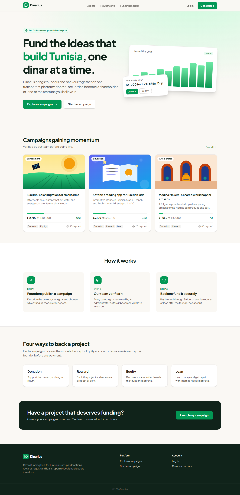
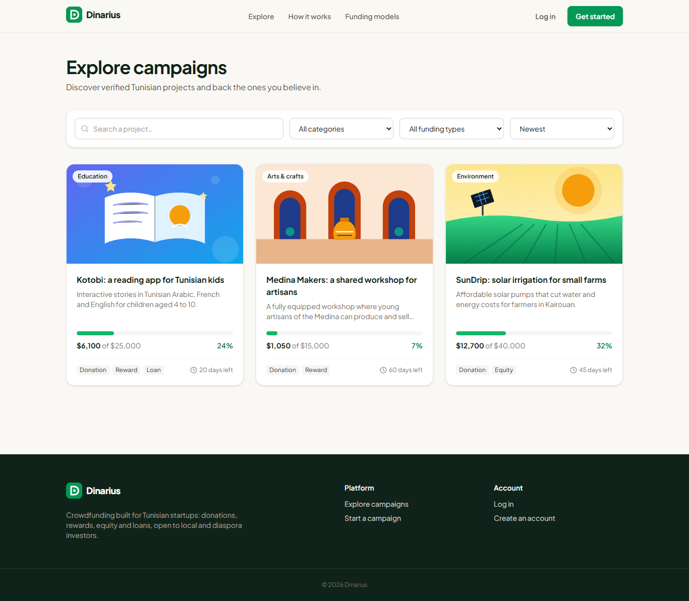
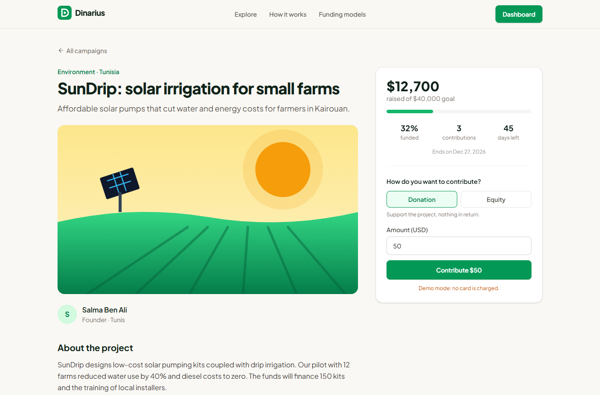
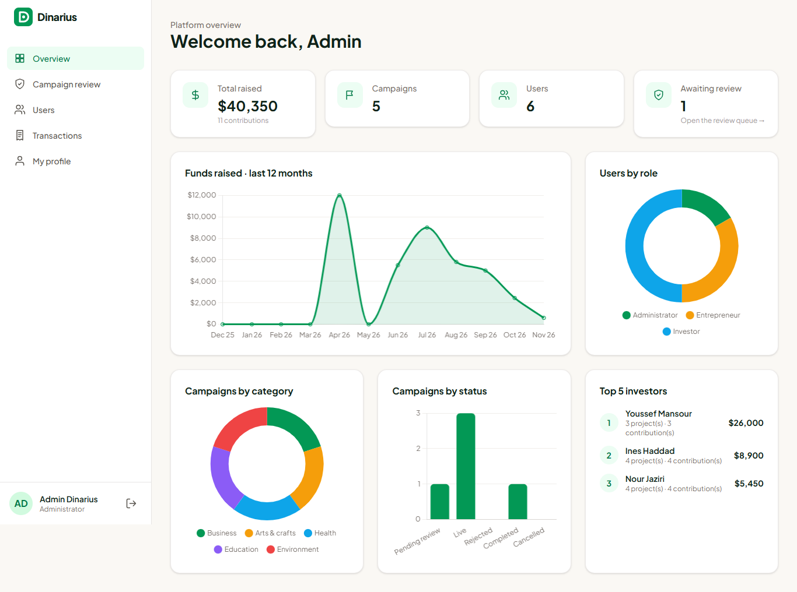
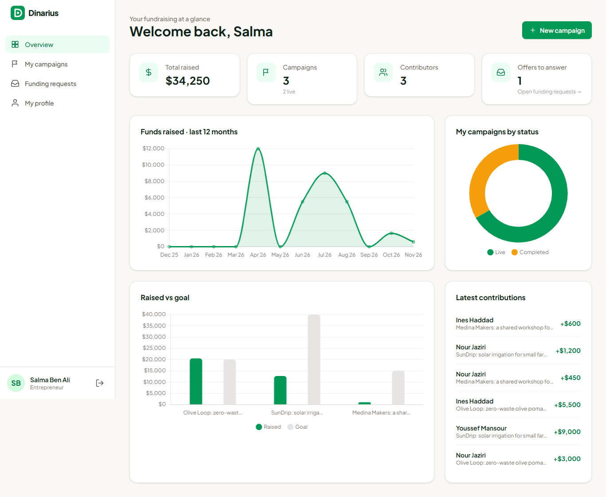
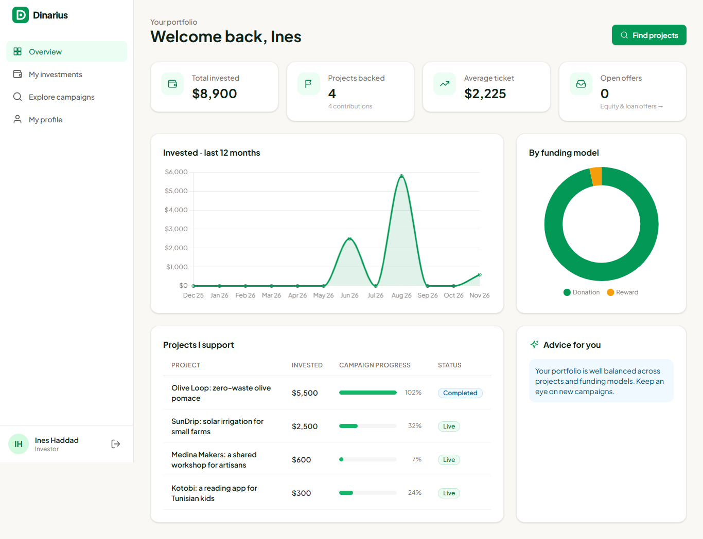
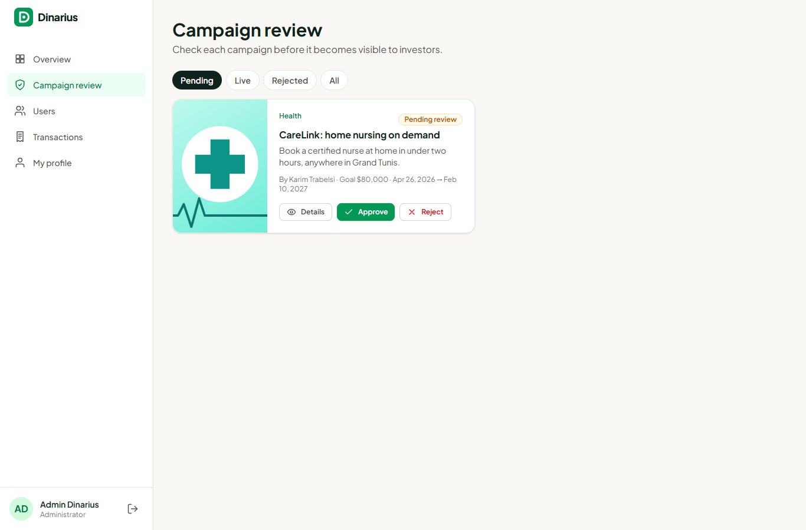

# Dinarius

**A crowdfunding platform for Tunisian startups, open to local and diaspora investors.**

Founders publish campaigns that an administrator verifies before they go live. Investors back them in four ways: **donation**, **reward**, **equity** or **loan**. Equity and loan offers must be accepted by the founder before any payment is made. Each role has its own dashboard with live statistics.



## Features

| Role | What they can do |
| --- | --- |
| **Visitor** | Browse and search live campaigns (category, funding model, sorting), read campaign pages |
| **Investor** | Donate or pledge through Stripe Checkout, send equity / loan offers with a message, pay accepted offers, cancel open ones, follow a portfolio dashboard with rule-based investment advice |
| **Entrepreneur** | Create and edit campaigns with a 4-step form and image upload, see them go through moderation, accept or decline offers, track funds raised, contributors and progress per campaign |
| **Administrator** | Approve or reject campaigns (with a reason emailed to the founder), manage users (create, change role, disable, delete), browse every transaction, platform-wide analytics and top investors |

Across the platform:

- JWT authentication with bcrypt hashing, optional **Google sign-in**, password reset by email, and tokens revoked when the password changes
- **Stripe Checkout** with a signed webhook and idempotent payment confirmation. Without a Stripe key, the app runs in a **demo payment mode** where no card is charged.
- Transactional **emails** (welcome, reset, review result, new offer, offer answer, contribution received) through any SMTP server, logged to the console in development
- A **scheduled job** (node-cron) that closes campaigns when they end and cancels their unanswered offers
- Moderation rules: editing a live campaign sends it back to review; a campaign that already received money is archived, never deleted
- Request validation with **zod**, rate-limited auth routes, Helmet, CORS allow-list, and a consistent JSON error format

## Screenshots

| Explore | Campaign page |
| --- | --- |
|  |  |

| Admin dashboard | Entrepreneur dashboard |
| --- | --- |
|  |  |

| Investor dashboard | Campaign review |
| --- | --- |
|  |  |

## Tech stack

**Frontend:** Angular 19 (standalone components, signals, new control flow, lazy-loaded routes), Tailwind CSS 4, Chart.js
**Backend:** Node.js 22, Express, MongoDB with Mongoose, zod, JWT, Passport (Google OAuth 2.0), Stripe, Nodemailer, node-cron, Multer
**Tooling:** Node test runner and Supertest, Docker Compose, nginx

## Getting started

### Prerequisites

- Node.js 20 or later
- MongoDB running locally (or a MongoDB Atlas connection string)

### 1. API

```bash
cd backend
npm install
cp .env.example .env      # defaults work for local development
npm run seed              # optional: demo users, campaigns and payments
npm run dev               # http://localhost:5000
```

### 2. Web app

```bash
cd frontend
npm install
npm start                 # http://localhost:4200
```

### Demo accounts

After `npm run seed`, every account uses the password **`Password123`**:

| Role | Email |
| --- | --- |
| Administrator | `admin@dinarius.dev` |
| Entrepreneur | `salma@dinarius.dev`, `karim@dinarius.dev` |
| Investor | `ines@dinarius.dev`, `youssef@dinarius.dev`, `nour@dinarius.dev` |

### Optional integrations

All of them are configured in `backend/.env`. The app works without them.

| Variable | Effect |
| --- | --- |
| `STRIPE_SECRET_KEY`, `STRIPE_WEBHOOK_SECRET` | Real card payments with Stripe Checkout (use test keys). Forward webhooks locally with `stripe listen --forward-to localhost:5000/api/webhooks/stripe`. |
| `GOOGLE_CLIENT_ID`, `GOOGLE_CLIENT_SECRET` | Shows the "Continue with Google" button. Authorized redirect URI: `http://localhost:5000/api/auth/google/callback`. |
| `SMTP_*` | Sends real emails instead of logging them. |

## Tests

The API has integration tests covering authentication, campaign moderation, payments, the equity offer flow, the dashboards and the scheduled job. They run against a throw-away `dinarius_test` database:

```bash
cd backend
npm test
```

## Docker

```bash
cp .env.example .env                 # set JWT_SECRET
docker compose up --build            # http://localhost:8080
docker compose exec api node src/scripts/seed.js --force   # optional demo data
```

nginx serves the Angular build and proxies `/api` and `/uploads` to the API container.

## Architecture

```
backend/
  src/
    config/        environment, MongoDB connection, Google strategy
    models/        User, Campaign, Investment
    validators/    zod schemas for every request body and query
    middleware/    auth (JWT, roles), validation, error handling
    controllers/   auth, users, campaigns, investments, stats
    services/      payments (Stripe / demo), mailer, investment advice
    jobs/          campaign lifecycle cron
    routes/        REST routes
  tests/           API integration tests
frontend/
  src/app/
    core/          models, API services, auth state, guards, interceptor
    shared/        UI kit (cards, charts, modal, badges, pagination…)
    layout/        public and dashboard shells
    pages/         public pages, auth, and one folder per dashboard role
```

### Investment lifecycle

```
donation / reward : pending ──► paid
equity / loan     : requested ──► accepted ──► pending ──► paid
                              └─► declined
any open state    : ──► cancelled (by the investor, or when the campaign ends)
```

### Main API routes

| Method | Route | Access |
| --- | --- | --- |
| `POST` | `/api/auth/register`, `/api/auth/login` | Public |
| `POST` | `/api/auth/forgot-password`, `/api/auth/reset-password` | Public |
| `GET` | `/api/campaigns`, `/api/campaigns/:id` | Public |
| `POST / PATCH / DELETE` | `/api/campaigns[/:id]` | Entrepreneur (owner) |
| `PATCH` | `/api/campaigns/:id/review` | Admin |
| `POST` | `/api/investments/checkout`, `/api/investments/engage` | Investor |
| `PATCH` | `/api/investments/:id/respond` | Entrepreneur |
| `GET` | `/api/stats/{admin,entrepreneur,investor}` | Matching role |
| `GET / POST / PATCH / DELETE` | `/api/users[/:id]` | Admin |

## Background

Dinarius started as a team project at the Faculty of Sciences of Tunis (2024–2025). This repository is a complete rewrite of that project.

## License

[MIT](LICENSE)
